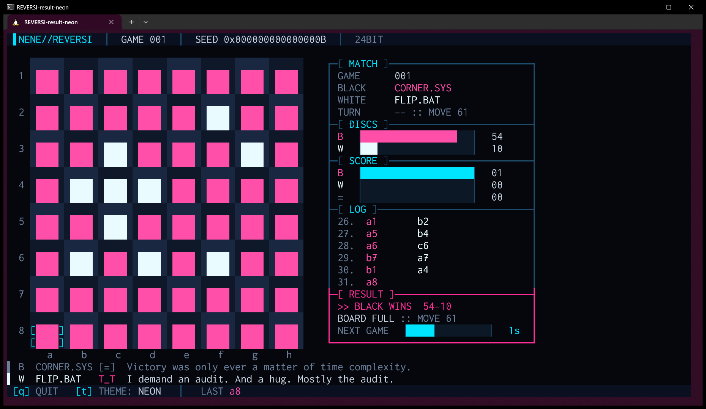
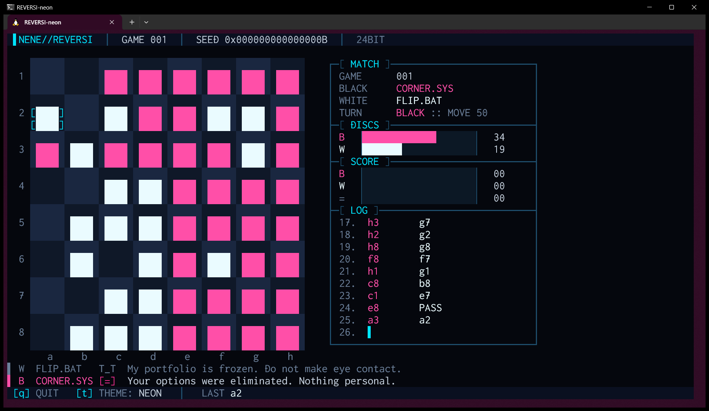
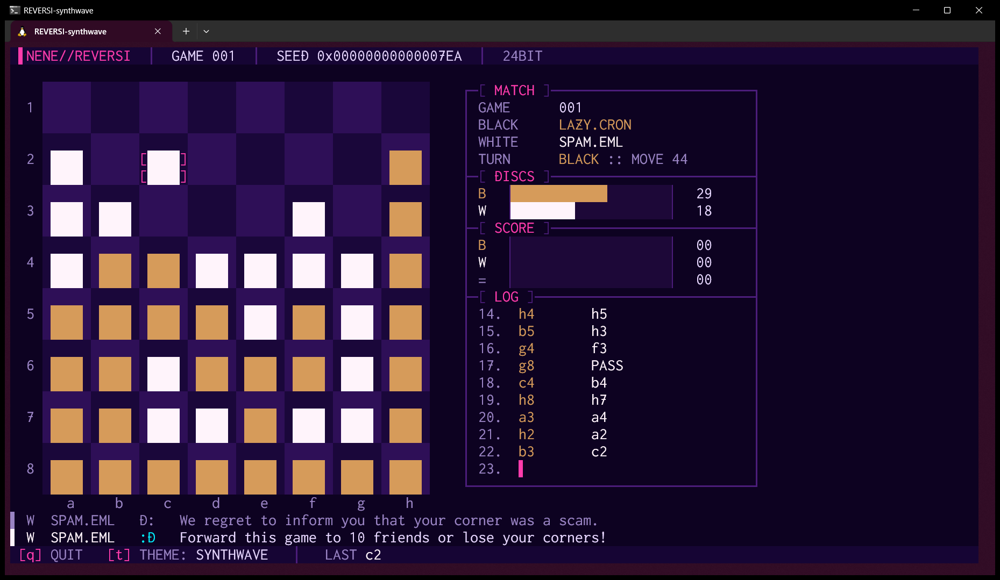
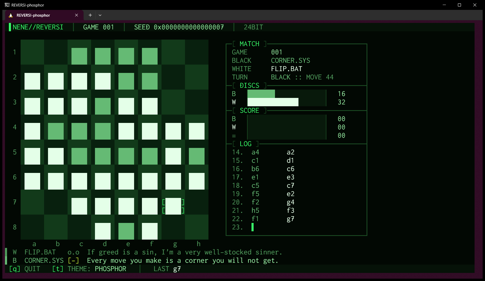
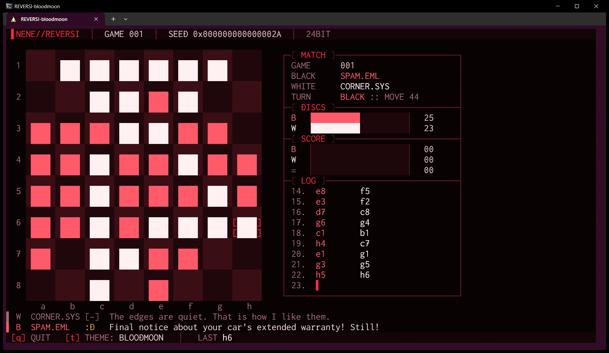
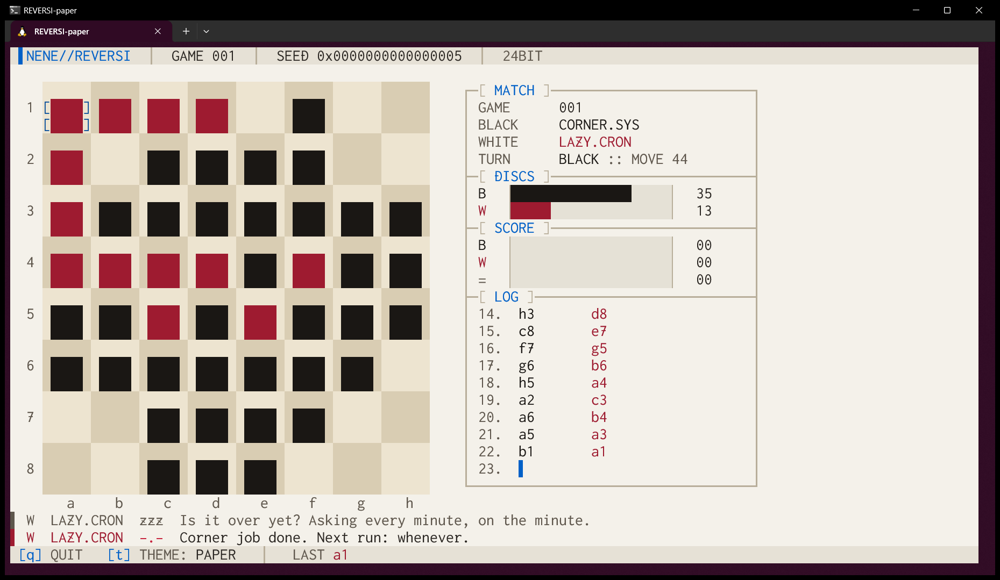

# NeNe Reversi

> *減らず口の 4 つのプログラムが、端末の中で延々とリバーシを打ち続けます。止めるには `q` を押してください。*

4 名のキャストが手作りの AI でリバーシを打ち続け、角を取るたびにひと言いう、端末のスクリーンセーバーです。
1 局が終わると次の局が始まります。何もしなくてかまいません。眺めて、ときどきニヤッとしてください。
チェス版の [NeNe Gambit](https://github.com/hideyukiMORI/nene-gambit) の兄弟です。

[](https://github.com/hideyukiMORI/nene-reversi/releases/latest)


[English](README.md) · **日本語**



<sub>実機の画面写真です。WSL2 の Windows Terminal で v0.1.0 の実行ファイルを動かしました（`--seed 11`・120×30・1859×1079 ピクセルで撮影）。
CORNER.SYS が盤を埋めて 54 対 10。FLIP.BAT は監査を要求しています。</sub>

> **ベータ版です。** v0.1.0 は最初のリリースです。見た目とキャストは、これから調整するかもしれません。

---

## インストール

```bash
curl -fsSL https://raw.githubusercontent.com/hideyukiMORI/nene-reversi/main/install.sh | bash
```

最新の [リリース](https://github.com/hideyukiMORI/nene-reversi/releases/latest) をダウンロードし、`SHA256SUMS` と照合してから `~/.local/bin/nene-reversi` にインストールします。
照合に失敗したときは何もインストールしません。スクリプトは [install.sh](install.sh) の 45 行ほどなので、パイプに流す前に 1 分もかからず読めます。

- 動作環境: x86_64 の Linux で glibc 2.35 以上（Ubuntu 22.04 以降）。WSL2 の Ubuntu と Windows Terminal で確かめています
- Swift は要りません。Swift の標準ライブラリを静的にリンクした 1 つのファイルで、動的に依存するのは libc・libm・libstdc++・libgcc_s だけです
- アンインストール: `rm ~/.local/bin/nene-reversi`

<details>
<summary>手作業でインストールする</summary>

```bash
v=0.1.0
curl -fsSL -O https://github.com/hideyukiMORI/nene-reversi/releases/download/v$v/nene-reversi-$v-linux-x86_64.tar.gz \
           -O https://github.com/hideyukiMORI/nene-reversi/releases/download/v$v/SHA256SUMS
sha256sum --check SHA256SUMS
tar -xzf nene-reversi-$v-linux-x86_64.tar.gz
./nene-reversi-$v-linux-x86_64/nene-reversi
```
</details>

## 遊び方（というより、眺め方）

```bash
nene-reversi
```

| キー | |
| --- | --- |
| `q` | 終了します（Ctrl+C でも終わります。どんな終わり方でも端末は元に戻ります） |
| `t` | 次のカラーテーマにします（全部で 12 種類） |

| オプション | |
| --- | --- |
| `--theme NAME` | `NEON` `PHOSPHOR` `AMBER` `SYNTHWAVE` `GLACIER` `BLOODMOON` `VAPOR` `MONO` `TOXIC` `GILDED` `ABYSS` `PAPER` |
| `--seed N` | 同じシードなら、同じ対局と**同じ会話**になります |
| `--move-interval SEC` | 1 手の間隔（既定は 1.0 秒） |
| `--result-pause SEC` | 終局後に結果を見せる時間（既定は 3 秒） |
| `--version` | 版を表示して終わります |

端末は 75×22 以上が必要です。**93×30 以上なら大きな盤**（1 升 6 桁 × 3 行）になります。
ウィンドウが小さすぎるときは、必要な大きさを 1 行で表示して待ちます。

### 画面の見方



- **盤**: 石は文字ではなく、石の色で塗ったブロックです。直前の手の升は `[ ]` で囲みます
- **MATCH**: 何局目か・黒と白を受け持つキャスト・どちらの手番か・何手打ったか
- **DISCS**: いまの石の数を棒で表示します
- **SCORE**: 黒の勝ち・白の勝ち・引き分けの通算です
- **LOG**: 直近の手を、黒と白で横に並べて表示します。パスも手の 1 つで、`PASS` と書きます。カーソル `▌` は次に打つ側の列に出ます
- **RESULT**: 終局すると出ます。勝った側と最後の石の数・終わった理由（`BOARD FULL` か `NO MOVES LEFT`）・次の局までの秒読み
- **COMMS**: 盤の下の 2 行で、キャストが最後に言ったことです。明るいほうが新しい行です

## キャスト

局が始まるたびに、4 名から 2 名を乱数で選んで黒と白に座らせます。打ち方がそれぞれ違い、うっとうしさもそれぞれ違います。

| | 打ち方 | 本人の弁 |
| --- | --- | --- |
| **FLIP.BAT** `$_$` | 欲張り。石を資産のように数え、たくさん返すのが大好き。3 手先まで読みます | *"Every disc on this board is a future asset. Mine, specifically."* |
| **CORNER.SYS** `[=]` | 冷静な策士。角と辺しか信じません。いちばん深い 4 手先まで読み、空き升が 10 以下なら最後まで読み切ります | *"Kernel loaded. Emotions unloaded."* |
| **SPAM.EML** `\o/` | 陽気な迷惑メール。2 手先まで読みますが、最善手からよく外れます。角は取ります | *"CONGRATULATIONS! You have been selected to lose at Reversi!"* |
| **LAZY.CRON** `zzz` | 働きたくない定期実行。返す石をなるべく少なくし、相手の打てる升を減らします。3 手先まで読みます | *"Scheduled to start. Not scheduled to try."* |

96 局を数えたところ、CORNER.SYS と LAZY.CRON はおよそ 4 局に 3 局勝ちますが、FLIP.BAT と SPAM.EML も 8 局に 1 局くらいは勝ちます。
セリフは 1 人 50 本で、出来事ごとに書いてあります（たくさん返した・返された・角を取った・取られた・パスした・パスさせた・静かな局面・勝ち・負け・引き分け）。
少しだけ紹介します。

> **FLIP.BAT**（負けたとき）*"Error: insufficient discs. Press any key to cry."*<br>
> **CORNER.SYS**（角を取ったとき）*"This square is permanent. Like my disappointment in you."*<br>
> **SPAM.EML**（角を取られたとき）*"ERROR 404: corner not found. Have you tried rebooting?"*<br>
> **LAZY.CRON**（パスするしかないとき）*"Pass. Best move I've made all day."*

残りの 196 本は、眺めながら集めてください。

## 12 のテーマ

`t` で順に替わります: `NEON`（既定）・`PHOSPHOR`（緑のブラウン管）・`AMBER`（琥珀のブラウン管）・`SYNTHWAVE`・`GLACIER`・`BLOODMOON`・`VAPOR`・`MONO`・`TOXIC`・`GILDED`・`ABYSS`・`PAPER`（唯一の明るいテーマ）。
配色は NeNe Gambit のもので、その上にリバーシ用の決まりを足しています。

| SYNTHWAVE | PHOSPHOR |
| --- | --- |
|  |  |
| **BLOODMOON** | **PAPER** |
|  |  |

どのテーマでも、英字と数字は背景に対して 4.5:1 以上のコントラストがあり、石は 2 色の升のどちらに対しても 3:1 以上、白黒の石どうしは明るさで 2.2:1 以上離れ、
**黒石は必ず暗いほうの色**です（理由は下で）。これを人の目では確かめていません。実際に描いたセルの色から、テストが毎回計算しています。

---

## 中身の話（7 つのエピソード）

NeNe Reversi はスクリーンセーバーの顔をしていますが、兄弟の Gambit と同じく**規則を人ではなく機械に守らせる実験**でもあります。
最初の規則からこのリリースまで、2026-10-25 と 26 の 2 日で進めました。以下の数字は、どれもリポジトリの記録（ADR・テスト・ゲートの証明）にあります。

### 1. AI は一から手作り。perft は記憶で書いたら間違えていた

リバーシのエンジンもライブラリも使っていません。製品の外部依存は 0 です。
合法手生成は **perft**（初期局面から深さ N までに起こりうる手の列の数）を公表値と突き合わせて確かめています。
リバーシではパスの数え方で値が変わるので、数え方は公表値を計算した人のコードに合わせました（パスは 1 手と数え、途中で終局した列は深さ N に届かないので数えない）。

期待値は独立した 2 つの出典（OEIS A124004 と Edax エンジンの出力）から写し、記憶では書いていません。このプロジェクトの決まりです。
その決まりが初日に効きました。深さ 10 の値を 24,571,284 と覚えていましたが、公表値は **24,571,056** でした。

- 深さ 1〜11、**合計 240,289,780 通り**が完全に一致します。パスは深さ 9 から、途中の終局は深さ 10 から現れるので、数え方まで確かめています
- 盤は黒と白の 64 ビットの整数 2 つです。深さ 11 は release 構成で約 5 秒で、`make check` のたびに回ります（[ADR 0005](docs/adr/0005-bitboards-and-move-representation.md)・[ADR 0006](docs/adr/0006-perft-counting-and-gate-depth.md)）
- 「パスか」「終局したか」を決める場所は 1 つだけです。パスしかできないとき合法手の一覧は `PASS` 1 つになり、終局すると空になります

### 2. 石は文字ではなく、塗ってある

NeNe Gambit は、Windows Terminal で駒記号をまっすぐ置くのに 4 往復かかりました。端末は駒記号を「1 桁」と答えて 2 桁で描き、ポーンは紫の絵文字になりました。
そこでこちらでは、**石を文字にしていません**。石の色で塗った空白のセルで、幅は偶数桁です。画面の文字はすべて ASCII です。例外は罫線の枠だけで、これも端末が 1 桁で描くと測れたときだけ使います。

### 3. 最初の実機の写真では、石ではなく柱が並んでいた

最初の設計では、石を小さな十字（3 行に 2・4・2 桁）で塗り、升の上端から下端まで届いていました。
Windows Terminal の最初の写真でその意味が分かりました。同じ列の石が**くっついて縦の柱になり**、数えられませんでした。
2 案を並べて撮り比べ、升の最上行をあける形にしました。いまは、石が升の最上行に触れたらテストが落ちます（[ADR 0009](docs/adr/0009-disc-blocks-leave-the-top-row.md)）。

### 4. 紙の上では、白が黒かった

12 のテーマの配色は NeNe Gambit のものです。明るい `PAPER` テーマでは、白の駒が墨色、黒の駒が赤で、チェスならそれで困りません。
リバーシでは、写真に**どう見ても黒い白石**が写っていました。石の色はそのまま石の意味なので、「黒石は 2 色のうち暗いほう」という決まりを足し、12 テーマすべてでテストしています。PAPER は 2 色を入れ替えました（[ADR 0011](docs/adr/0011-cyber-hud-themes-and-frame.md)）。

### 5. 時計を読まない AI を、対局を数えて調整した

探索は秒数ではなく、決まった深さとノード数で打ち切ります。盤・AI・描画のコードは、時刻・乱数・環境変数を**読めません**。読もうとすると自作の検査がビルドを落とします。
乱数はシード付きの SplitMix64 から引くので、`--seed 42` なら毎回同じ対局と同じ減らず口になります。

最初の重みでは、強い 2 名が弱い 2 名に **64 局中 64 局**、40〜60 石差で勝ちました。それではスクリーンセーバーとして退屈です。
弱い 2 名には空いた角の隣の升を怖がることを覚えさせ、強い 2 名には手の揺らぎの幅を広げ、96 局を数え直して、弱い側が 12.5% 勝つようにしました（[ADR 0010](docs/adr/0010-evaluation-search-and-cast.md)）。

### 6. 規則は書くだけでなく、守らせる

リポジトリには 72 の規則があり、それぞれ ID と、機械が守らせているかどうかの状態を持っています。いま **51 が active**（破ると `make check` が落ちる）で、残りは「予定（planned）」や「機械では塞げない」と正直に書いてあります（[品質ゲート](docs/QUALITY_GATES.md)）。
製品コードを書く前に、Swift 6.4.1 を 75 のケースで実測しました（[phase0-results.json](docs/quality/phase0-results.json)）。たとえば `case (let x):`・`case .a, _:`・`case (_, _):` は、どれも黙って `switch` の網羅性の検査を殺します。
そして**兄弟プロジェクトの検査は 3 つとも通していました**。このリポジトリの検査はどれも捕まえます。
検査は、落ちるのを見るまで信用しません。違反を 1 つずつ仕込んだ **64 件**と、何も仕込まない対照 1 件を回し、どれも意図した規則で捕まりました（[ゲートの証明](docs/quality/gate-proofs.md)）。

### 7. README が見つけた不具合

この README の写真を撮っていたら、COMMS の 2 行がどちらも CORNER.SYS の世間話でした。
静かな局面のひと言は 6 手ごとに「いま打った側の相手」が言う決まりで、6 は偶数なので、静かな区間の中では**いつも同じキャラクター**になっていました（続いた組の 57 組中 55 組）。
先にテストを書いて落ちるのを見てから直し、いまは話し手をコイントスで決めています（51 組中 24 組）。

---

## 開発

```bash
make bootstrap           # clone 直後に 1 回（コミットフックと、静的リンクの SwiftLint）
make check               # 唯一の完了定義。ローカルと CI で同じ（ビルド・perft を含むテスト・整形・lint・規約検査・端末の smoke・コミットの形）
make release TAG=v<版>   # 配布物を作る（検査に通ったときだけ）
```

- Swift 6.4.1（`.swift-version`）・SwiftPM のみ・製品の外部依存は 0。ソースは約 2,900 行、テストは約 900 行です
- 入口は [CLAUDE.md](CLAUDE.md)（日本語）と [AGENTS.md](AGENTS.md)（英語）です。設計の判断は 13 本の [ADR](docs/adr/README.md)、要件と施主の決定は [REQUIREMENTS.md](docs/REQUIREMENTS.md) にあります
- 人も AI も同じ規則と同じゲートの下で書きます。ここのコードは Claude Code が書き、方向付けと決定はプロジェクトのオーナーが行いました

## ライセンス

MIT（[LICENSE](LICENSE)）
